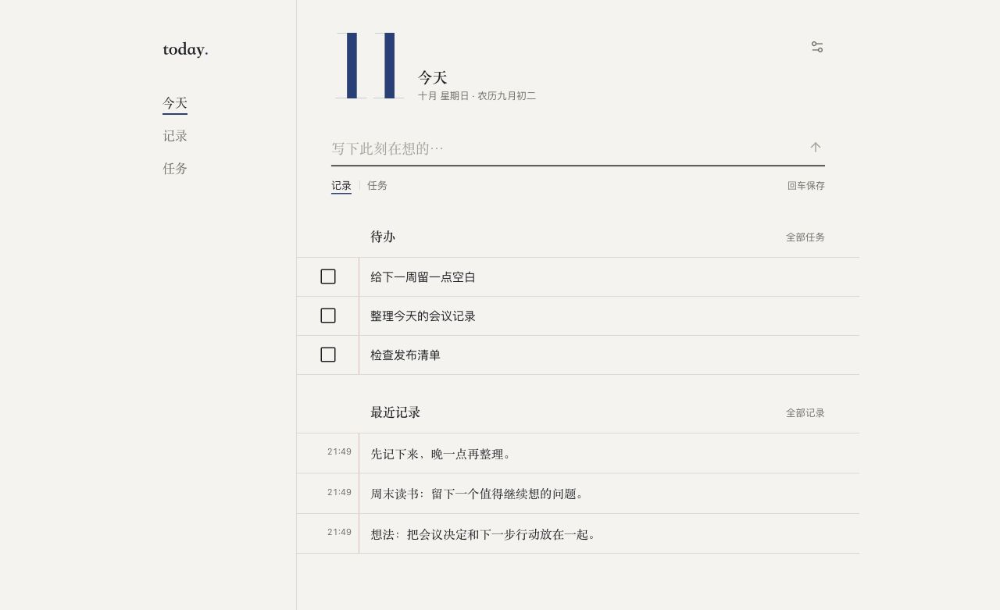
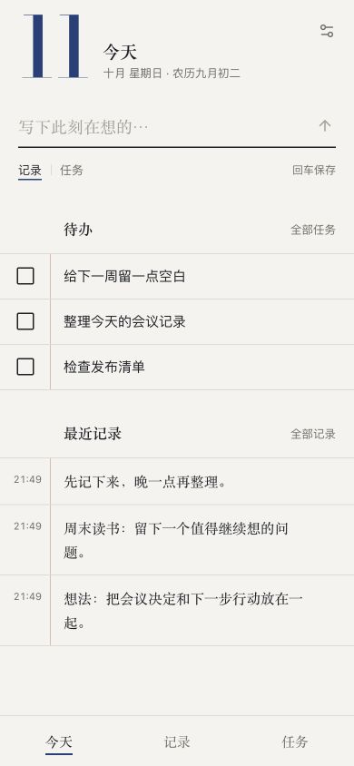
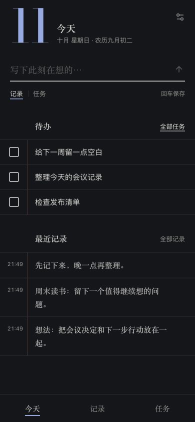

# Today Workspace

Capture notes and tasks without an account, keep working offline, and sync across devices when you sign in.

[](https://github.com/chivopic/today-workspace/actions/workflows/today-workspace-android.yml)

[Try the web app](https://today-workspace.vercel.app) · [Android releases](https://github.com/chivopic/today-workspace/releases) · [Quickstart](#quickstart) · [简体中文](./README.zh-CN.md)

A personal notebook for thoughts and next actions, with a Chinese-language interface. Use it in a browser, install it as a PWA, or run the same app on Android. Current source version: **0.4.0**.

## Preview



| Mobile · light | Mobile · dark |
| --- | --- |
|  |  |

Actual browser captures of v0.4.0 with sample notes and tasks, signed out. Mobile images show the responsive web app, not a native Android capture. [Capture details](./docs/development.md#screenshots).

## Why use it?

- **Start with a thought, not a setup flow.** Save a note immediately, switch to task mode, or type `/task Buy milk`. No account is required for local use.
- **Keep writing through a lost connection.** Notes and tasks are saved to IndexedDB; pending changes wait locally for a later sync. Failed saves retain your input and show an error.
- **Keep the next action in view.** Today shows up to four open tasks and four recent notes. Search notes, filter tasks, and undo the most recent deletion within six seconds.
- **Take a backup with you.** Export notes and tasks as JSON. Import merges newer records without clearing the existing collection.

Optional email sign-in adds cross-device sync, a pending-change count, and manual sync. It currently binds local data to one account per browser profile and origin; see [sync behavior and limits](./docs/architecture.md#sync-behavior).

## Quickstart

Requires **Node.js 22.12+**, npm, and a browser with IndexedDB enabled. Internet access is needed to install dependencies.

```bash
git clone https://github.com/chivopic/today-workspace.git
cd today-workspace
npm ci
npm run dev
```

Open the local URL printed by Vite, normally `http://localhost:5173`. You should see **今天** (Today), an input box, and an initial example note and task. Enter `Try a smaller daily plan` and press Enter; the note should still be there after a refresh.

**No `.env` file or account is needed for this local workflow.** The source currently contains the hosted service's public cloud configuration. To connect your own backend, read [cloud configuration](./docs/architecture.md#cloud-configuration): the database schema and RPC migrations are not included in this repository.

## Try these workflows

### Capture now, find it later

On **今天** (Today), leave **记录** (Note) selected and enter:

```text
Idea: keep meeting decisions next to the next action.
```

Open **记录** in the navigation and search for `meeting`. Click the note to edit it, or use **新建** (New) for a longer entry.

### Turn a thought into a task

Enter this on Today, even while Note mode is selected:

```text
/task Review the release checklist
```

The text after `/task` becomes an open task. Check it off, then open **任务 → 已完成** (Tasks → Completed) to find it again. Plain `/task` without content does not create a task.

### Back up before moving browsers

Open **设置 → 导出 JSON** (Settings → Export JSON). In the destination browser, use **导入 JSON** (Import JSON) to merge that backup. Version 2 and legacy version 1 backups are accepted; newer local revisions are preserved.

Local storage belongs to the current browser profile and origin. Changing the host or port uses a different local store, and clearing site data removes it. Export before moving or clearing data.

## How it works

```text
Capture / edit / complete / delete
                |
                v
       IndexedDB transaction
       +--------------------+
       | record + outbox    |----> render saved local state
       +--------------------+
                |
         online + signed in
                v
       upload pending changes
                |
                v
       Supabase -> pull pages -> merge into IndexedDB
```

The UI waits for the local write, not the network. Sync runs on local changes, sign-in, reconnection, and returning to the page; it is not a live subscription. Each sync currently scans remote pages, rather than fetching only changes since the last sync.

The PWA caches the app after a successful online load of the production build. Offline reopening depends on that cache; test it with the [production preview](./docs/development.md#build-and-preview), not only the dev server.

## Documentation

| Read this | For |
| --- | --- |
| [Development and deployment](./docs/development.md) | Tests, build, project map, Android setup, hosting, screenshots, and roadmap |
| [Data and sync](./docs/architecture.md) | Schema, backups, conflict handling, account binding, and cloud setup limits |
| [Android release guide](./RELEASE.md) | Signing, APK / AAB outputs, checksums, release verification, and beta email limits |
| [GitHub Releases](https://github.com/chivopic/today-workspace/releases) | Downloads and generated release notes |

## Contributing and license

Bug reports, focused fixes, accessibility improvements, and documentation contributions are welcome. Read [CONTRIBUTING.md](./CONTRIBUTING.md) for setup, test expectations, data-safety guidelines, and the pull request workflow. Issues and PRs may be written in English or Chinese.

Licensed under the [MIT License](./LICENSE). Third-party components retain their own license terms.

Originally developed in [chivopic/my-software](https://github.com/chivopic/my-software), Today Workspace became a separate repository on 2026-09-06. Earlier commit history remains in that repository.
